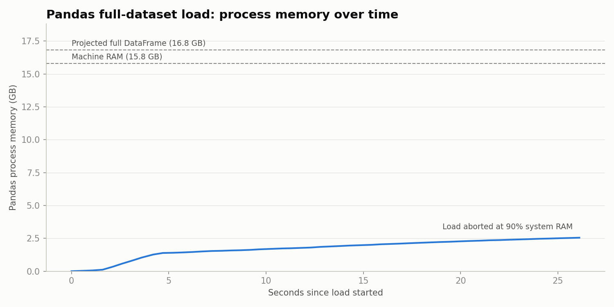

# Project Report - Large-Scale E-Commerce Transaction Analytics

## 1. Executive summary

A synthetic e-commerce dataset of **25 million transactions (2.78 GB of compressed
Parquet)** was generated with Faker and processed end to end with PySpark. Pandas
could load a 1M-row sample, but the measured footprint (689 MB per million rows)
projects to **~16.8 GB for the full dataset - more than the machine's 15.8 GB of RAM** -
and a live attempt had to be aborted at 90 % system memory. Spark completed every
stage on the same machine, inside an 8 GB Docker VM: quality assessment (88.36 %
clean rows), cleaning (24.5M rows retained), 21 analytical queries across five query
groups, and a performance study in which caching, a broadcast join and AQE cut a
benchmark workload by **33.9 %**, and four threads ran a query **1.65x** faster than one.

## 2. Dataset statistics

| Item | Value |
|------|-------|
| Records | 25,000,000 |
| Size on disk | 2.78 GB, Snappy Parquet |
| Files / partitions | 1,800 files across 36 `year_month` partitions |
| Date range | 2022-01-01 to 2024-12-31 |
| Generation | 20.4 min (~20,500 records/s), peak memory 600 MB |
| Customers / products | 250,000 customers, 480 products in 8 categories |

The generator writes in 500k-row batches, so memory stays flat (~500-600 MB)
regardless of dataset size. Faker is used to build pools of names, cities,
countries and products once; rows are then assembled with vectorised numpy
sampling. Calling Faker per field per row was measured at well under 1,000 rows/s
(over 7 hours for 25M rows), versus ~20k rows/s with the pooled approach.

Realistic structure was built in: payment methods 40/30/20/10 %, 85 % success rate,
an evening peak in shopping hours, a weekend uplift, November/December seasonality
and ~15 % year-on-year growth.

## 3. Data quality findings

Assessment ran in a single aggregation pass over all 25M rows
([data_quality_report.csv](outputs/reports/data_quality_report.csv)):

| Issue | Rows | % |
|-------|------|---|
| Missing email | 1,000,859 | 4.00 |
| Missing city | 1,000,985 | 4.00 |
| Negative price | 62,863 | 0.25 |
| Negative quantity | 61,969 | 0.25 |
| `total_amount` != price x quantity | 499,379 | 2.00 |
| Duplicate `transaction_id` | 375,000 | 1.50 |
| Price outliers (\|z\| > 3) - flagged, not removed | 698,852 | 2.80 |
| **Rows free of any issue (quality score)** | 22,090,487 | **88.36** |

No critical nulls, out-of-range timestamps or invalid email formats were found.

**Cleaning decisions**

| Step | Decision | Why |
|------|----------|-----|
| Negative price/quantity | Remove (124,832 rows) | Cannot be repaired - the true value is unknown |
| Duplicate `transaction_id` | Keep first (`dropDuplicates`) | Exact copies; double-counting would inflate revenue |
| Missing city / email | Fill `Unknown` / `unknown@example.com` | Non-critical fields; dropping 8 % of rows would bias revenue |
| Wrong `total_amount` | Recompute as `price x quantity` | Price and quantity are the source of truth |
| Strings | Trim; upper-case `payment_method`, `country`, `status`; lower-case email | Consistent grouping keys |
| Price outliers | Keep | Legitimately expensive products (e.g. Electronics), not errors |

Result: **25,000,000 -> 24,502,089 rows (-1.99 %)**. A validation pass on the
written data confirmed zero bad prices, quantities, nulls, mismatches and duplicates.

Engineered features: `year`, `month`, `quarter`, `day_of_week`, `transaction_date`,
`transaction_hour`, `is_high_value` (> $500) and `revenue` (successful transactions
only). Cleaned data is stored partitioned by `year`/`month`.

## 4. Key business insights

- **Revenue is $14.40 B** over three years, growing every year, with a strong
  **December peak** ($701 M in Dec 2024 vs ~$430 M in a typical 2024 month).
  The top 5 months by transactions are all Novembers and Decembers.
- **Electronics dominates revenue** ($5.27 B, 37 %) despite having the same number of
  transactions as every other category (~2.6M each) - it is driven entirely by price
  (average $674 vs $29 for Food). All top-20 products by revenue are Electronics,
  while top products by units are spread across categories.
- **Payment mix** matches the 40/30/20/10 design, and average order value is
  identical (~$692) across methods - payment method does not influence basket size.
- **Weekends carry 25 % more transactions** than any weekday (~4.1M vs ~3.26M).
  **Peak hours are 18:00-21:00** (20:00 is busiest at 1.87M transactions);
  04:00 is the quietest (170k).
- **Success rate is flat at ~85 % in every quarter**, and the highest failure rate of
  any product is 15.4 %, barely above the 15 % average - no product or period is
  unusually failure-prone.
- **Customers:** 250,000 customers averaging ~98 orders each; median average order
  value $686. 120,249 customers (48 %) spend above the average customer.

**Limitation:** because the data is synthetic and sampled uniformly, differences
between countries and between products in the same category are random noise rather
than real signal. With ~98 orders per customer, no customer has only failed
transactions (that query correctly returns no rows). Real data would show much
stronger skew.

## 5. Pandas vs Spark

| Test | Rows | Time | Memory | Result |
|------|------|------|--------|--------|
| Pandas 1M-row sample | 1,000,000 | 4.6 s | 689 MB | Success |
| Pandas full (projected) | 25,000,000 | ~115 s | ~16.8 GB | Exceeds 15.8 GB RAM |
| Pandas full (attempted) | - | aborted at 26 s | system RAM at 90 % | Killed by memory guard |
| Spark full (load + explore + count) | 25,000,000 | 197 s | ~3.5 GB | Success |

A 2.78 GB compressed dataset expands roughly **6x** in Pandas, mainly because every
string becomes a Python object. Pandas must hold the whole DataFrame in memory;
Spark streams Parquet partitions through executors and only materialises
aggregates, so the full pipeline ran inside an 8 GB container.

The full Pandas load ran in a child process with a memory guard that kills it at
90 % system memory, so the demonstration could not freeze the machine.
The memory trace is in [pandas_memory_trace.csv](outputs/reports/pandas_memory_trace.csv)
and the chart below.

## 6. Performance results

**Baseline vs optimised**
([performance_results.csv](outputs/reports/performance_results.csv)). The benchmark
is a workload of four actions on the cleaned data: a product-revenue query with two
aggregations, a join to category averages and a `dense_rank` window, plus three
further aggregations that reuse the same data.

| Configuration | Workload time |
|---------------|---------------|
| Baseline: no cache, broadcast joins disabled, AQE off, 200 shuffle partitions | 41.8 s |
| Optimised: column pruning + `cache()`, broadcast hint, AQE on, 16 shuffle partitions | **27.6 s (-33.9 %)** |
| One-off cost of materialising the cache | 34.1 s |

The execution plans show the change directly: the baseline joins with a
**SortMergeJoin** that shuffles both sides
([explain_baseline.txt](outputs/reports/explain_baseline.txt)); the optimised plan
uses a **BroadcastHashJoin** reading from an **InMemoryTableScan**
([explain_optimized.txt](outputs/reports/explain_optimized.txt)).
Caching only pays off when data is reused: the 34 s cache cost is recovered after
about 2.4 runs of this workload (14.2 s saved per run), so it suits iterative or
interactive analysis, not a single query.

**Parallelism**

| Master | Time |
|--------|------|
| `local[1]` | 11.1 s |
| `local[4]` | 6.7 s (1.65x) |

The speed-up is well below 4x because the query has shuffle stages and file I/O that
do not parallelise perfectly. `local[1]` also ran first, against colder file caches,
which slightly favours `local[4]`.

**Stage timings on the full data**: load and explore 197 s, quality assessment 708 s,
cleaning and write 1,469 s; analytics query groups 69-209 s each
([analytics_timings.csv](outputs/reports/analytics_timings.csv)).

## 7. Technical learnings

- **Lazy evaluation:** transformations only build a plan; time is spent in actions
  (`count`, `show`, `write`). Calling several actions on uncached data repeats the
  whole read.
- **One pass instead of many:** computing every quality check as conditional sums
  in a single `agg()` reads 25M rows once instead of 20 times.
- **Shuffles dominate cost:** `groupBy`, `dropDuplicates`, joins and windows trigger
  exchanges; broadcasting a small table removes one, and AQE coalesces small shuffle
  partitions automatically.
- **Avoid `collect()` inside transformations:** the original notebook computed a
  revenue percentage with a nested `collect()`; a window
  (`sum(...).over(Window.partitionBy())`) does it in one plan.
- **Partitioning:** writing cleaned data partitioned by `year`/`month` lets
  date-filtered queries skip whole directories.

## 8. Challenges faced

- **PySpark on Windows:** pyspark 4.1.0 fails to import on Windows
  (`socketserver.UnixStreamServer`), and Spark needs `winutils.exe` to write files.
  Running Spark in a Docker container (Python 3.12 + Java) solved both and made the
  project reproducible.
- **Generator speed:** per-row Faker calls were far too slow for 25M rows, which led
  to the pooled, vectorised design above.
- **Measuring Pandas fairly:** the machine had only ~3 GB of RAM free before the test,
  so the live attempt hit the guard early. Projecting from a measured 1M-row sample
  gives a figure (16.8 GB) that does not depend on what else is running.
- **Docker bind-mount I/O:** reading 2.8 GB from a Windows folder into the Linux VM is
  slower than native disk, which inflated the quality-assessment and cleaning times.

## 9. Conclusion

All success criteria are met: 25M records (target 20-50M), 2.78 GB (minimum 2 GB),
successful cleaning in Spark, 21 queries across 5 query groups (including window
functions and Spark SQL), a documented Pandas limitation, and measurable optimisation
gains. The main lesson is that Spark's value comes from not needing the whole
dataset in memory, and that Spark performance is mostly about controlling
shuffles and data reuse.
