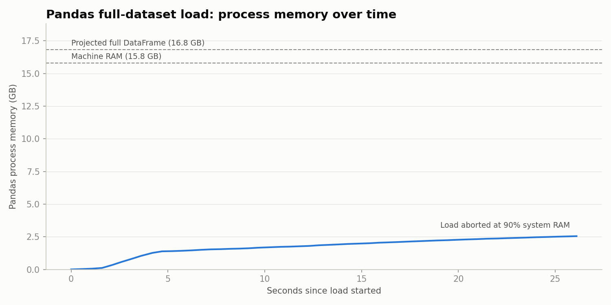

# Large-Scale E-Commerce Transaction Analytics with Apache Spark

Generates a synthetic e-commerce dataset (10M+ transactions, multiple GB of Parquet)
with Faker, shows why Pandas struggles with it, then cleans, analyses and optimises
it with PySpark. See [specification.md](specification.md) for the full brief.

## Project structure

```
.
├── data/                      # generated, git-ignored (folders kept with .gitkeep)
│   ├── raw/                   # Stage 1 output - Parquet partitioned by year_month
│   ├── cleaned/               # Stage 5 output - Parquet partitioned by year/month
│   └── analytics/             # Stage 6 output - one CSV folder per query
├── src/
│   ├── config.py              # paths, dataset distributions, Spark settings
│   ├── utils.py               # logger, SparkSession builder, timer, CSV export
│   ├── generate_data.py       # Stage 1   - data generation
│   ├── pandas_test.py         # Stage 2   - Pandas limitation demo
│   ├── spark_cleaning.py      # Stage 3-5 - load, quality report, cleaning
│   ├── spark_analytics.py     # Stage 6   - 5 query groups + Spark SQL
│   ├── spark_optimization.py  # Stage 7   - caching / broadcast / parallelism
│   └── visualizations.py      # Stage 8   - charts
├── notebooks/                 # exploratory notebooks (scripts are the source of truth)
├── outputs/
│   ├── visualizations/        # PNG charts
│   └── reports/               # quality report, timings, explain plans, screenshots
├── logs/                      # one log file per script
├── PROJECT_REPORT.md
├── requirements.txt
└── specification.md
```

## Setup

~15 GB free disk is needed for the full dataset.

### Option A - Docker (recommended, especially on Windows)

The image bundles Python 3.12, a Java runtime and all requirements, so there is no
local Java/Hadoop setup. The project folder is mounted at `/app`, so data and
outputs appear in your local folders.

```bash
docker compose build
docker compose run --rm spark python src/generate_data.py --records 25000000
```

Prefix every command in the table below with `docker compose run --rm spark`.
The Spark UI is at <http://localhost:4040> while a job runs.

### Option B - local Python

Requirements: Python 3.10+, **Java 17 or 21** (needed by PySpark 4.x).

```bash
python -m venv venv
source venv/bin/activate        # Windows: venv\Scripts\activate
pip install -r requirements.txt
```

Running Spark natively on Windows is not recommended: pyspark 4.1.0 fails to import
there (`socketserver.UnixStreamServer`), and writing files needs `winutils.exe` /
`HADOOP_HOME`. Use Docker instead. `generate_data.py` and `pandas_test.py` do not use
Spark and run fine natively.

## How to run

All scripts use paths relative to the project root, so you can run them from anywhere.
Run them in order:

| Step | Command | Output |
|------|---------|--------|
| 1. Generate data | `python src/generate_data.py --records 20000000` | `data/raw/`, `logs/data_generation.log` |
| 2. Pandas test | `python src/pandas_test.py` | `outputs/reports/pandas_test_results.csv` |
| 3-5. Clean | `python src/spark_cleaning.py` | `data/cleaned/`, `outputs/reports/data_quality_report.csv`, `cleaning_summary.csv` |
| 6. Analytics | `python src/spark_analytics.py` | `data/analytics/*`, `outputs/reports/analytics_timings.csv` |
| 7. Optimisation | `python src/spark_optimization.py` | `outputs/reports/performance_results.csv`, `explain_*.txt` |
| 8. Charts | `python src/visualizations.py` | `outputs/visualizations/*.png` |

Useful flags:
- `generate_data.py --records N --batch-size N --seed N --overwrite`
- `pandas_test.py --sample-rows N --skip-full`
- `spark_optimization.py --skip-parallelism`

Tip: do a quick end-to-end smoke test with `--records 200000` before generating the full dataset.

## Dataset

14 columns per spec section 3.1. Transactions are spread over 2022-01-01 to 2024-12-31,
8 product categories, 4 payment methods (40/30/20/10 %) and an 85/15 SUCCESS/FAILED
split. Intentional quality issues: ~4 % missing city and ~4 % missing email, ~1.5 %
duplicate transactions, 0.5 % negative price/quantity, 2 % wrong `total_amount`.

## Results

Full run on a 16 GB / 8-core Windows laptop; Spark ran in Docker (8 GB VM).
Details and discussion are in [PROJECT_REPORT.md](PROJECT_REPORT.md).

| Metric | Value |
|--------|-------|
| Records generated | 25,000,000 |
| Raw size on disk | 2.78 GB (1,800 Snappy Parquet files, 36 monthly partitions) |
| Generation time / peak memory | 20.4 min / 600 MB |
| Data-quality score (raw) | 88.36 % of rows free of any issue |
| Rows after cleaning | 24,502,089 (497,911 removed, 1.99 %) |
| Successful revenue 2022-2024 | $14.40 B |

### Pandas vs Spark

| Test | Rows | Time | Memory | Result |
|------|------|------|--------|--------|
| Pandas - 1M-row sample | 1,000,000 | 4.6 s | 689 MB DataFrame | Success |
| Pandas - full dataset (projected from sample) | 25,000,000 | ~115 s | **~16.8 GB** | Exceeds the machine's 15.8 GB RAM |
| Pandas - full dataset (attempted) | - | aborted at 26 s | 90 % of system RAM | Memory guard killed the load |
| Spark - full dataset (load, explore, count) | 25,000,000 | 197 s | ~3.5 GB container | Success; full pipeline completed |



### Performance optimisation

| Experiment | Seconds |
|------------|---------|
| Baseline workload (no cache, sort-merge join, AQE off) | 41.8 |
| Optimised workload (cache + broadcast join + AQE + column pruning) | 27.6 (**-33.9 %**) |
| One-off cache materialisation | 34.1 |
| Window/join query on `local[1]` | 11.1 |
| Same query on `local[4]` | 6.7 (**1.65x faster**) |

Execution plans: [explain_baseline.txt](outputs/reports/explain_baseline.txt) (SortMergeJoin)
vs [explain_optimized.txt](outputs/reports/explain_optimized.txt) (BroadcastHashJoin over InMemoryTableScan).

### Outputs

- `outputs/query_results/` - 21 analytics results as CSV
- `outputs/visualizations/` - 7 charts
- `outputs/reports/` - quality report, cleaning summary, timings, Pandas results, execution plans

## Technologies

Python, PySpark 4.1, Faker, PyArrow/Parquet, Pandas, Matplotlib.
